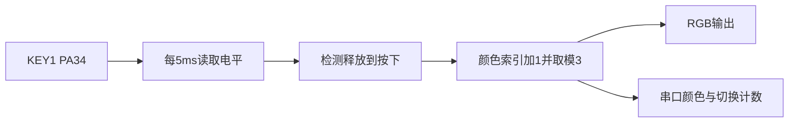

# 方案设计说明（T1）

文档编号：DOC-02；版本：v0.1，已确认、待实现；记录人：殷白玉；日期：2026-10-10。

## 1. 设计输入

依据 DOC-01。SDK v2.5.1，板型 sf32lb52-lchspi-ulp。沿用 RGB 初始化和构建配置，不修改 project/ 骨架。

## 2. 总体架构

## 3. 模块划分与需求追踪

| 模块 | 职责 | 需求 | 代码位置 | 测试 |
|---|---|---|---|---|
| 按键采样 | 读实际引脚，只报告按下边沿 | REQ-002 | 拟新增 src/key.c、key.h | TC-002、TC-004 |
| 颜色状态 | 红绿蓝循环，更新计数 | REQ-001 | src/main.c | TC-001、TC-004 |
| RGB输出与日志 | 点亮当前颜色、打印记录 | REQ-001、REQ-102 | src/main.c | TC-001、TC-102 |

## 4. 接口与状态

按键初始化时保存实际电平；随后每5ms采样。只有上次为释放、本次为按下时产生事件，持续按住和释放不产生事件。颜色初始为红，索引按 (index+1)%3 更新。第一版不滤除电平抖动。

## 5. 硬件资源

KEY1：BSP_KEY1_PIN=34、高有效，来源为 SDK 的 customer/boards/sf32lb52-lchspi-ulp/hcpu/board.conf 及生成配置。rt_pin_read、rt_pin_mode、输入模式宏来自 rtos/rtthread/components/drivers/include/drivers/pin.h。RGB 初始化沿用 src/main.c：PA32、GPTIM2_CH1、LDO3、rgbled。

## 6. 软件运行

在现有主线程中轮询，不另建线程，不使用中断回调。每轮读按键、按需输出颜色，再调用 rt_thread_mdelay(5)。启动时执行无外设副作用的边沿和颜色循环自检，串口输出 PASS/FAIL；自检后重新读取真实按键电平。

## 7. 关键决策

选择5ms轮询，备选为GPIO中断。Codex说明两者权衡后，殷白玉选择轮询。见 adr/0001-key-polling.md。

## 8. 非功能设计

REQ-101、REQ-103 通过课程脚本编译和查看容量报告验证。REQ-102：只有按下事件才能更新状态。REQ-104：用3分钟运行与之后的按键操作验证；不据此宣称长期稳定或低功耗。

## 9. 风险与备选

未消抖可能导致一次按下产生多次事件；5ms采样也可能漏掉极短脉冲。按TC-002实测，如有重复则保留失败证据，更新设计后加消抖。20次未复现时追加30次，仍正常则记录未复现，保留已知风险。

## 10. 物理验证计划

编译后由殷白玉烧录，先确认初始红色，再按10次检查顺序，按20次统计切换数，提供串口日志和视频。未取得证据前，不填写测试通过。

## 11. 需求—设计追踪

| 需求 | 设计位置 |
|---|---|
| REQ-001 | 第3、4节：颜色循环、输出与日志 |
| REQ-002 | 第3、4节：边沿检测，消抖风险见第9节 |
| REQ-101 | 第8节：指定工具编译 |
| REQ-102 | 第4、8节：非按下事件不更新颜色 |
| REQ-103 | 第8节：构建容量报告 |
| REQ-104 | 第8、10节：短时运行与实机验证 |
