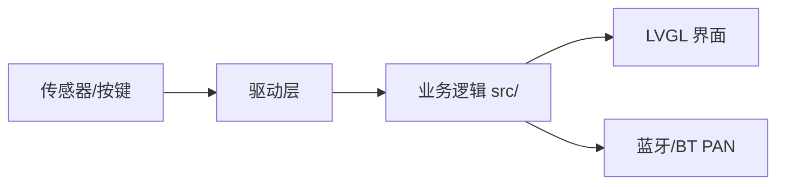

# 方案设计说明

| 项 | 内容 |
|---|---|
| 文档编号 | DOC-02 |
| 项目名称 | <项目名称> |
| 版本 / 状态 | v0.1 / 草稿 |
| 负责人 / 日期 | <姓名> / <YYYY-MM-DD> |

## 修订记录

| 版本 | 日期 | 修改人 | 修改内容 | AI参与 |
|---|---|---|---|---|
| v0.1 | <日期> | <姓名> | 创建 | 否 |

> 写作提示：设计要能回答“每条需求由哪个模块实现、怎么验证”。设计变更时先改本文档再改代码，并更新 `adr/`。

## 1. 设计输入

- 需求来源：`01-需求规格说明.md`（版本 v<x.y>）
- 硬件平台：黄山派 SF32LB525UC6，板型 sf32lb52-lchspi-ulp；SDK 版本：v2.5.1（课程统一）
- 约束：<例：无 WiFi；Flash/RAM 上限；功耗预算>

## 2. 总体架构

> 画一张图（Mermaid 或手绘拍照放 `docs/img/`），标出模块划分与数据流向，并能对着图逐块讲清职责。

## 3. 模块划分与需求追踪

| 模块 | 职责 | 对外接口 | 实现的需求 | 代码路径 | 测试 |
|---|---|---|---|---|---|
| <例：debounce> | <按键消抖> | `debounce_update()` | REQ-001 | `src/debounce.c` | TC-001 |
| <例：rgb_led> | <RGB 灯颜色与闪烁> | `rgb_led_set_color()` | REQ-002 | `src/main.c` | TC-002 |

## 4. 接口设计

### 4.1 软件接口

| 接口 | 输入 | 输出 | 错误处理 | 说明 |
|---|---|---|---|---|
| <函数/消息> | | | | |

### 4.2 数据结构与状态机

<关键结构体、状态转移表/图>

## 5. 硬件资源分配

| 外设 | 用途 | 引脚/总线 | 参数 | 来源（原理图/例程） |
|---|---|---|---|---|
| <例：I2C> | <IMU> | <引脚> | <速率> | <链接> |

## 6. 软件运行设计

- RT-Thread 线程/定时器规划：<线程名、优先级、栈大小、周期>
- 同步与通信：<信号量/消息队列/事件>
- 时序与实时性：<关键路径的时限>

## 7. 关键技术选型与决策

| 决策 | 备选方案 | 选择理由 | 决策人 | ADR |
|---|---|---|---|---|
| <决策> | <备选> | <理由> | <学生/agent建议+学生确认> | adr/0001-xxx.md |

## 8. 非功能设计

- 功耗：<策略>　性能：<策略>　资源：<预算>　可靠性：<看门狗/异常处理>

## 9. 风险与备选方案

| 风险 | 概率 | 影响 | 应对 / Plan B | 台账编号 |
|---|---|---|---|---|
| <风险> | | | | R-01 |

## 10. 物理验证计划

> 提前列出需要真机验证的节点，agent 到这些节点会暂停等待你的证据。

| 验证节点 | 验证内容 | 通过判据 | 对应需求 | 计划里程碑 |
|---|---|---|---|---|
| <例：固件启动> | <串口日志出现 xxx> | <判据> | REQ-001 | M2 |

## 11. 需求—设计追踪

| 需求ID | 设计章节/模块 | 说明 |
|---|---|---|
| REQ-001 | 3 模块 debounce | <示例> |
| REQ-002 | 3 模块 rgb_led | <示例> |
| REQ-101 | 6 软件运行设计 / 8 非功能设计 | <示例：性能> |
| REQ-102 | 8 非功能设计 | <示例：功耗> |
| REQ-103 | 8 非功能设计 | <示例：资源> |
| REQ-104 | 8 非功能设计 | <示例：可靠性> |
